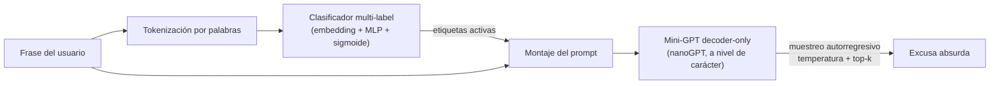

# 🎭 Generador de Excusas Absurdas

> Un proyecto educativo de Machine Learning **desde cero** en Python: dos modelos trabajando juntos (un clasificador y un mini-GPT) y dos paneles web para **ver, tocar y romper** lo que pasa por dentro.


Le escribes un marrón («*Se me ha reventado el coche en la M-30*») y devuelve una excusa absurda («*Una bandada de palomas con prisa ha secuestrado mi tubo de escape*»).
La excusa es lo de menos: **el objetivo es entender cómo se entrena y cómo funciona un modelo de lenguaje**.

## 📸 Capturas

### Panel de Inferencia: el modelo pensando, paso a paso


### Laboratorio: entrenar, romper y comparar teoría vs. práctica


## 💡 Por qué existe

Entender un Transformer en una diapositiva es una cosa; ver qué ocurre cuando cambias un número y el entrenamiento se rompe es otra. Este proyecto nace de la necesidad de **tener algo con lo que experimentar**:

- Ver qué parámetros tiene un modelo, qué hace cada uno y qué pasa al modificarlo.
- Entrenar *mal* a propósito (learning rate disparado, modelo diminuto, pocas iteraciones) y comprobar por qué falla.
- Observar cómo **dos modelos encadenados** se pasan información.
- Ver, carácter a carácter, qué probabilidades asigna el modelo y dónde «mira» con la atención.

## 🧠 Cómo funciona



**Paso A · Clasificador (multi-label).** Recibe la frase y devuelve un conjunto de etiquetas (`['VEHICULO']`, `['PAREJA', 'COMPRAS']`…). Una sigmoide por etiqueta con `BCEWithLogitsLoss`, porque las etiquetas no son excluyentes.

**Paso B · Generador (Mini-GPT).** Un Transformer decoder-only escrito a mano en PyTorch (atención causal multi-cabeza, residuales, LayerNorm). Se entrena con el formato:

```
[CATEGORIA: CLIMA][CATEGORIA: VEHICULO] TÚ: <frase del usuario> -> EXCUSA: <excusa absurda>
```

En inferencia se monta el mismo prompt hasta `EXCUSA:` y el modelo lo continúa carácter a carácter hasta el salto de línea.

> ⚠️ El formato del prompt debe ser **idéntico** en entrenamiento e inferencia: si no, la calidad se hunde sin dar ningún error.

## ✨ Qué incluye

**🔍 Panel de Inferencia**
- Pipeline paso a paso: texto → tokens → etiquetas (con umbral y casillas manuales) → prompt → generación.
- Top-10 del siguiente carácter en vivo: probabilidad pura vs. tras temperatura y top-k.
- Mapa de atención por capa y cabeza, vector de cada capa y mapa 2D de embeddings.
- **Línea temporal**: vuelve a cualquier paso de la generación y reprodúcela.
- Mandos: temperatura, top-k, umbral, longitud máxima, velocidad y semilla.

**🧪 Laboratorio**
- Entrena el clasificador y el generador desde el navegador.
- Previsión teórica antes de entrenar: parámetros, memoria, tiempo, pasadas al corpus y loss esperado.
- Curva de loss real frente a la prevista y a referencias (qué lograría un modelo más simple).
- Muestras de texto durante el entrenamiento para ver cómo pasa de ruido a excusa.
- Tabla final **teoría vs. práctica** con lectura automática (sobreajuste, aprendizaje lento…).

## 🚀 Instalación rápida

Necesitas Python 3.10 o superior.

```bash
git clone https://github.com/<tu-usuario>/generador-excusas-ml.git
cd generador-excusas-ml

python -m venv venv
# Windows (CMD):   venv\Scripts\activate.bat
# Linux / macOS:   source venv/bin/activate

pip install -r requirements.txt
python datos.py        # genera los datasets a partir de semilla.txt
python server.py       # abre http://127.0.0.1:8000
```

1. En **Laboratorio**, entrena primero el *Clasificador* (segundos) y luego el *Generador* (en CPU, usa el preset «CPU rápida»).
2. En **Inferencia**, escribe una frase y mira qué pasa.

Guía detallada para Windows (CMD) y Kali/Linux, uso de GPU y problemas habituales: **[docs/INSTALACION.md](docs/INSTALACION.md)**.

> El panel carga Chart.js desde un CDN, así que necesita conexión a internet para dibujar las gráficas.

## 🗂 Estructura

```
├── semilla.txt        # Datos editables: 12 categorías, 480 frases, 360 excusas
├── datos.py           # semilla.txt -> data/clasificador.csv + data/corpus.txt
├── clasificador.py    # Paso A: clasificador multi-label
├── generador.py       # Paso B: Mini-GPT (estilo nanoGPT)
├── excusas.py         # Flujo completo por terminal (sin paneles)
├── server.py          # API FastAPI de los paneles
├── static/index.html  # Paneles de Inferencia y Laboratorio
└── docs/              # Instalación, parámetros y capturas
```

## 🎛 Parámetros que puedes tocar

Todo está explicado (qué hace cada uno y cómo afecta al modelo) en **[docs/PARAMETROS.md](docs/PARAMETROS.md)**. Resumen:

| Dónde | Parámetros |
|---|---|
| Inferencia | umbral, temperatura, top-k, longitud máxima, semilla |
| Generador | `block_size`, `n_layer`, `n_head`, `n_embd`, `dropout`, `lr`, `batch_size`, `max_iters`, `eval_interval` |
| Clasificador | `lr`, `batch_size`, `epochs` |

## 🗃 Los datos

`semilla.txt` define **12 categorías**: 6 simples (`CLIMA`, `COMPRAS`, `MASCOTA`, `PAREJA`, `SALUD`, `VEHICULO`) y 6 mixtas de dos etiquetas (`CLIMA+VEHICULO`, `COMPRAS+PAREJA`, `MASCOTA+SALUD`, `MASCOTA+VEHICULO`, `PAREJA+SALUD`, `CLIMA+COMPRAS`), cada una con 40 frases y 30 excusas. `datos.py` valida el archivo y genera el corpus, añadiendo un 15 % de ejemplos que combinan dos categorías al azar.

Puedes añadir tus propias frases, excusas o categorías editando el archivo; después ejecuta `python datos.py` y vuelve a entrenar.

## ⚠️ Limitaciones (a propósito)

- El dataset es **sintético y repetitivo**: el F1 de validación del clasificador sale casi perfecto porque hay fuga entre entrenamiento y validación. Mídelo con frases propias.
- El generador trabaja a **nivel de carácter**: es didáctico, pero a temperatura alta inventa palabras.
- La previsión de loss del laboratorio es una **heurística calibrada con pruebas reales**, no una ley física; la tabla final te dice cuánto se equivocó.
- No es un modelo para producción: es un laboratorio para aprender.

## 🔒 Nota de seguridad

- El servidor escucha solo en `127.0.0.1` y **no tiene autenticación**: no lo expongas a internet.
- Los modelos se cargan con `torch.load(..., weights_only=True)`. Aun así, no cargues archivos `.pt` de procedencia desconocida.

## 🛣 Ideas para seguir

- [ ] Tokenizador BPE en vez de caracteres.
- [ ] Guardar varios checkpoints con nombre y compararlos en el panel.
- [ ] Muestreo top-p y penalización de repeticiones.
- [ ] Ajuste fino (fine-tuning) de un modelo preentrenado y comparación con el Mini-GPT.
- [ ] Clasificador con un codificador Transformer.

## 📄 Licencia

[MIT](LICENSE).

## 👤 Autor

**Felipe Corredor** · [LinkedIn](https://www.linkedin.com/in/felipecorredorfont)

Si lo has probado o se te ocurre cómo mejorarlo, abre un *issue* o cuéntamelo. 🙌
